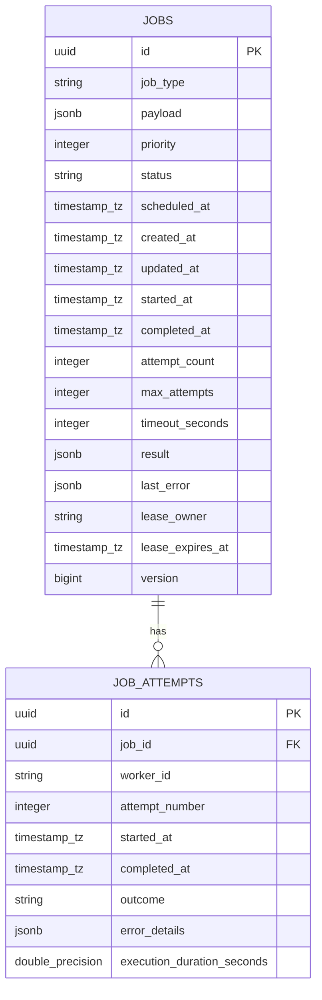

# Distributed Job Scheduling Platform

A high-performance, durable, priority-aware, crash-resilient Distributed Job Scheduling Platform built in Python 3.12, FastAPI, PostgreSQL, and Redis.

Designed with core distributed systems principles: PostgreSQL as the authoritative source of truth, atomic row-level leasing with fencing tokens, dynamic priority scheduling with tie-breaking, at-least-once delivery with cooperative cancellation, and automatic background crash recovery.

---

## Architecture Diagram

```mermaid
flowchart TD
    Client([HTTP Consumer / Client]) -->|REST API Requests| API[FastAPI Web Service]
    API -->|1. Commit Job (status=QUEUED)| PG[(PostgreSQL Authoritative DB)]
    API -->|2. Buffer Job ID| RedisQueue[(Redis Ready Queue ZSET)]

    subgraph Schedulers [Scheduler Daemon Pool]
        Sched1[Scheduler Daemon]
    end

    Sched1 -->|Poll Due Jobs with FOR UPDATE SKIP LOCKED| PG
    Sched1 -->|Push Due Job IDs| RedisQueue

    subgraph Workers [Worker Process Pool]
        W1[Worker Process 1]
        W2[Worker Process 2]
        WN[Worker Process N]
    end

    RedisQueue -->|ZPOPMIN (Priority Fetch)| W1 & W2 & WN
    W1 & W2 & WN -->|Atomic Claim with Version Fencing| PG
    W1 & W2 & WN -->|Heartbeat Lease Extensions| PG
    W1 & W2 & WN -->|Write Final Result or Failure| PG

    subgraph Recovery [Self-Healing Daemons]
        Reaper[Lease Sweeper & Reconciler]
    end

    Reaper -->|Reclaim Expired Leases| PG
    Reaper -->|Reconcile Desynced Jobs| RedisQueue
```

---

## Key Features & Distributed Systems Design

1. **Dual-Store Durability with Authoritative Relational DB**:
   - PostgreSQL is the sole authoritative authority for job definitions, state transitions, leases, version fencing, and execution attempt logs.
   - Redis functions purely as an ephemeral dispatch buffer to prevent database connection contention. If Redis restarts or drops keys, the self-healing recovery daemon automatically reconstructs the queue directly from PostgreSQL.
2. **Lock-Free Concurrency via Row-Level Locking (`FOR UPDATE SKIP LOCKED`)**:
   - Schedulers claim due jobs in batches using `SELECT ... FOR UPDATE SKIP LOCKED`. Multiple schedulers can run concurrently without race conditions, blocking, or deadlocks.
3. **Optimistic Fencing Tokens against Stale Workers**:
   - Every state transition increments `jobs.version`. If a worker's lease expires while it is temporarily unresponsive, the recovery daemon reclaims the job and advances the version token. When the stale worker returns, its result write affects 0 rows and is rejected.
4. **Dynamic Priority Scheduling with Deterministic Tie-Breaking**:
   - Jobs are scheduled according to:
     $$\text{ORDER BY priority DESC, scheduled_at ASC, created_at ASC, id ASC}$$
5. **Full Jitter Exponential Backoff**:
   - Retries calculate delays using truncated exponential backoff with full jitter to avoid the "thundering herd" problem on downstream resources.
6. **Cooperative Cancellation Protocol**:
   - Cancellation requests update PostgreSQL and broadcast abort signals over Redis pub/sub. Long-running handlers poll `context.cancellation_token.raise_if_cancelled()` to terminate execution cooperatively.

---

## Technology Stack

- **Runtime**: Python 3.12
- **Web API**: FastAPI & Pydantic v2 (Pydantic Settings)
- **Database & ORM**: PostgreSQL 16, SQLAlchemy 2.0 (asyncpg for async API/workers, psycopg for sync migrations)
- **Migrations**: Alembic with versioned DDL
- **Queue & Ephemeral Coordination**: Redis (redis-py async with hiredis)
- **Testing**: pytest, pytest-asyncio, pytest-cov, HTTPX
- **Code Quality**: Ruff (linter & formatter), mypy (static type analysis)
- **Containerization & CI**: Docker, Docker Compose, GitHub Actions

---

## Job Data Model & Lifecycle

### Entity-Relationship Schema



### State Machine Matrix

| State | Allowed Transitions |
|:---|:---|
| `SCHEDULED` | `QUEUED`, `CANCELLED` |
| `QUEUED` | `RUNNING`, `CANCELLED` |
| `RUNNING` | `SUCCEEDED`, `FAILED`, `RETRY_WAIT`, `CANCELLED` |
| `RETRY_WAIT`| `QUEUED`, `CANCELLED` |
| `SUCCEEDED` | *(Terminal state)* |
| `FAILED` | `QUEUED` (via manual retry endpoint) |
| `CANCELLED` | `QUEUED` (via manual retry endpoint) |

---

## Built-In Registered Job Handlers

Only trusted, pre-registered handlers can be executed:

1. **`math.calculate`** (`CalculationHandler`):
   - Computes deterministic operations (`sum`, `multiply`, `factorial`, `fibonacci`).
   - Validates mathematical inputs and fails permanently on non-retryable errors (e.g. negative factorial).
2. **`notification.simulate`** (`NotificationSimHandler`):
   - Simulates multi-channel notification delivery (`email`, `sms`, `push`).
   - Supports configurable simulated latency and simulated transient network failures (`simulate_failure_rate`) for retry testing.
3. **`report.generate`** (`ReportSimHandler`):
   - Simulates CPU/IO intensive report generation in incremental chunks with cancellation checks.
   - Computes reproducible checksums across processed rows.

---

## Verified Performance & Concurrency Benchmark

Benchmark methodology: 100 jobs of mixed priorities submitted, dispatched, and executed concurrently using 4 worker execution threads on local PostgreSQL 16 and Redis 8 on macOS Darwin arm64.

| Metric | Verified Measurement |
|:---|:---|
| **Jobs Processed** | 100 / 100 successful |
| **Worker Concurrency** | 4 concurrent worker tasks |
| **Submission Throughput** | **710.4 jobs/second** |
| **Execution Throughput** | **529.2 jobs/second** |
| **Handler Latency (p50)** | **3.60 ms** |
| **Handler Latency (p95)** | **9.50 ms** |
| **Handler Latency (p99)** | **13.70 ms** |
| **Handler Latency (Average)** | **4.04 ms** |

---

## REST API Endpoints Overview

| Method | Endpoint | Description |
|:---|:---|:---|
| `GET` | `/health/live` | Process liveness probe |
| `GET` | `/health/ready` | Readiness probe (validates PostgreSQL & Redis connectivity) |
| `POST`| `/api/v1/jobs` | Submit job for immediate or future scheduled execution |
| `GET` | `/api/v1/jobs/{job_id}` | Retrieve job details, lease status, and result |
| `GET` | `/api/v1/jobs` | List jobs with pagination, status, and type filtering |
| `POST`| `/api/v1/jobs/{job_id}/cancel` | Cancel an eligible job (supports cooperative abort of running jobs) |
| `POST`| `/api/v1/jobs/{job_id}/retry` | Manually retry a failed or cancelled job |
| `GET` | `/api/v1/jobs/{job_id}/attempts` | Retrieve complete execution attempt history |
| `GET` | `/api/v1/metrics/summary` | Aggregate operational metrics and telemetry |

Full curl examples and sample JSON responses are documented in [docs/api-examples.md](docs/api-examples.md).

---

## Local Development & Setup

### Prerequisites
- Python 3.12+
- PostgreSQL 16+
- Redis 7+

### 1. Environment Setup
```bash
# Clone and enter directory
cd "DISTRIBUTED JOB SCHEDULING PLATFORM"

# Create virtual environment
python3.12 -m venv .venv
source .venv/bin/activate

# Install dependencies in editable mode
pip install -e ".[dev]"

# Copy environment configuration
cp .env.example .env
```

### 2. Database Migrations
```bash
# Apply migrations to head
alembic upgrade head
```

### 3. Running Services Locally
In separate terminal windows:
```bash
# Start API Service
uvicorn app.main:app --host 0.0.0.0 --port 8000 --reload

# Start Scheduler Daemon
python -m app.scheduler.scheduler

# Start Worker Process Pool
python -m app.workers.worker

# Start Crash Recovery Daemon
python -m app.services.recovery_service
```

---

## Docker & Docker Compose

Run the entire cluster with a single command:
```bash
docker compose up --build
```

### Scaling Worker Replicas
Scale workers dynamically without downtime:
```bash
docker compose up -d --scale worker=4
```

### Checking Container Health & Logs
```bash
docker compose ps
docker compose logs -f api worker scheduler recovery
```

---

## Testing & Quality Assurance

### Run Unit & Integration Tests
```bash
pytest --cov=app --cov-report=term-missing tests/
```

### Run Static Analysis & Formatting
```bash
ruff check .
ruff format --check .
mypy app
```

### Run Concurrency Benchmark
```bash
python tests/benchmark_concurrency.py
```

---

## SDE Interview Mentorship & Deep-Dive Notes

### 1. Why not Celery?
- **Durability**: Celery treats message brokers as authoritative. If Redis runs out of memory or crashes, unacknowledged jobs can be lost. Our platform treats PostgreSQL as the durable, transactional source of truth.
- **Fencing Tokens**: Celery has no built-in optimistic concurrency tokens on database updates. If a worker pauses and restarts, it can overwrite newer task results.
- **Audit Trails**: Celery requires external add-ons (Flower/django-celery-results) to record attempts. Here, `JobAttempt` is a first-class citizen.

### 2. How does `SELECT ... FOR UPDATE SKIP LOCKED` work?
- `FOR UPDATE` places exclusive row-level locks on matching rows.
- `SKIP LOCKED` instructs PostgreSQL to immediately bypass rows that are already locked by another transaction, rather than blocking.
- Result: Multiple scheduler replicas run concurrently with zero lock contention and zero double-scheduling.

### 3. At-Least-Once Execution vs Exactly-Once Execution
- True "exactly-once" execution in distributed networks is mathematically impossible without two-phase commit on all side effects (Two Generals' Problem).
- We guarantee **at-least-once execution** with database idempotency protection via unique attempt records and version fencing tokens.

---

## Documentation Index

- [Detailed Architecture Specification](docs/architecture.md)
- [Failure Modes & Recovery Guide](docs/failure-recovery.md)
- [REST API Reference & Curl Examples](docs/api-examples.md)
- [Render Cloud Deployment Guide](docs/RENDER_DEPLOYMENT.md)

---

## License
MIT License.
